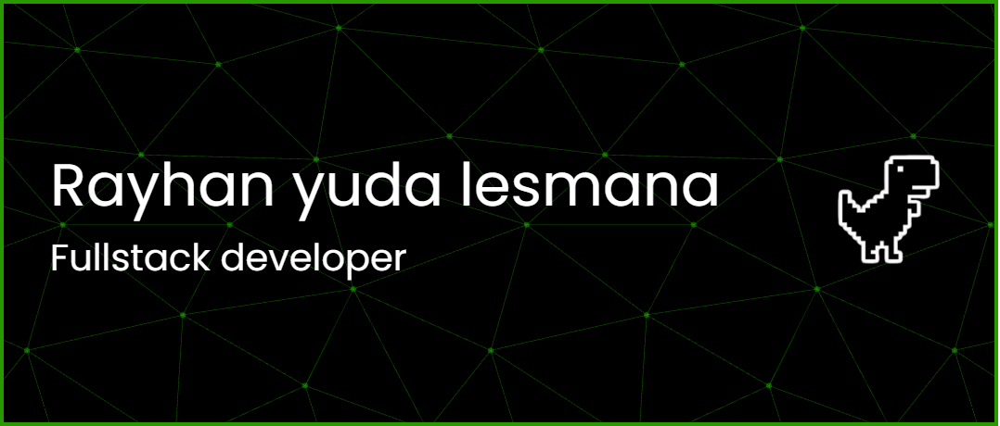

  

  
  
  
  

  

  

    
    
    
  

---

### Glad to see you here!

Hey! I'm **Rayhan**, a **Fullstack Web Developer** based in **Bandung, Indonesia**, and you've reached my corner of the web.

I love building web applications from the ground up, connecting clean, responsive interfaces with solid backend logic. For the past 4 years, I've been shipping web products at **PT Swamedia Informatika** and for freelance clients, ranging from public API portals and developer dashboards to inventory, accounting, and booking platforms.

Whether I'm crafting interactive components in **React** and **Next.js** or wiring up REST APIs and database schemas in **Laravel**, **Express.js**, and **Python**, I care most about making software that feels fast, intuitive, and dependable for the people using it every day.

Feel free to look around my repos or drop a message if you want to talk about web development, swap ideas, or build something cool together!

### Talking about Personal & Dev Stuff:

- I build fullstack web apps with     and 
- Currently deep-diving into backend services & API design using  and 
- Enjoy solving tricky frontend state bugs, refactoring legacy codebases, and designing clean REST API contracts.
- Ask me about **React**, **Next.js**, **Laravel**, **API integration**, or turning business ideas into working web apps!
- Fun fact: `Equal is Not Always Equal in JS` (`[] == ![]` evaluates to `true`).
- Reach me out: 

 

---

### Languages and Tools:

  
  
  
  
  
  
  
  
  
  
  
  
  
  
  
  
  

---

### Projects and Dev Stuff:

  
<samp>&#9776;</samp> <b>GitHub Stats & Top Languages</b> <i>(click to expand)</i>

   
  

    
    
  

  
<samp>&#9776;</samp> <b>GitHub Streaks</b> <i>(click to expand)</i>

   
  

    
  

  
<samp>&#9776;</samp> <b>Web Apps & Systems I've Built</b> <i>(click to expand)</i>

   
  <table>
    <thead align="center">
      <tr>
        <td><b>System / Product</b></td>
        <td><b>What It Does</b></td>
        <td><b>Stack</b></td>
      </tr>
    </thead>
    <tbody>
      <tr>
        <td><b>APIcentrum Suite</b> <i>(Portal, Devportal & Publisher)</i></td>
        <td>A public API catalog with interactive endpoint docs, paired with developer & publisher portals for app registration, API subscriptions, and key generation.</td>
        <td>
          
          
          
        </td>
      </tr>
      <tr>
        <td><b>Loccana Endira & Celebit</b> <i>(Inventory & Accounting Web App)</i></td>
        <td>End-to-end back-office platform handling master data, stock movements, purchasing, sales, cash/bank ledgers, financial reports, and role permissions.</td>
        <td>
          
          
          
        </td>
      </tr>
      <tr>
        <td><b>Diarium</b> <i>(Enterprise Web App)</i></td>
        <td>Interactive web workspace where I build reusable React components, ship new UI features, and squash production bugs.</td>
        <td>
          
          
        </td>
      </tr>
      <tr>
        <td><b>Car Rental & Fleet Booking</b> <i>(Fullstack Web App)</i></td>
        <td>Real-time vehicle booking platform with fleet availability tracking, dynamic frontend pages, and a custom REST API.</td>
        <td>
          
          
          
        </td>
      </tr>
      <tr>
        <td><b>Talent & Career Mapping Platform</b> <i>(HR Web App)</i></td>
        <td>Internal recruitment and employee career pathing application built alongside the official PT Swamedia Informatika web portal.</td>
        <td>
          
          
          
        </td>
      </tr>
    </tbody>
  </table>
   

  
<samp>&#9776;</samp> <b>Things I Use to Get Stuff Done</b> <i>(click to expand)</i>

   
  <ul>
    <li><b>Code Editor:</b> VS Code</li>
    <li><b>Frontend Stack:</b> React.js, Next.js, Tailwind CSS, Bootstrap, jQuery</li>
    <li><b>Backend & APIs:</b> Laravel, Express.js, Python</li>
    <li><b>Databases:</b> PostgreSQL & MySQL</li>
    <li><b>API Testing & Docs:</b> Postman & Apidog</li>
    <li><b>Version Control:</b> Git & GitHub</li>
  </ul>

---

### Contribution Activity

  <picture>
    <source media="(prefers-color-scheme: dark)" srcset="https://raw.githubusercontent.com/Rayhanyl/Rayhanyl/output/pacman-contribution-graph-dark.svg" />
    <source media="(prefers-color-scheme: light)" srcset="https://raw.githubusercontent.com/Rayhanyl/Rayhanyl/output/pacman-contribution-graph.svg" />
    
  </picture>

  
<samp>&#9776;</samp> <b>Switch to Snake Contribution Graph</b> <i>(click to expand)</i>

   
  

    <picture>
      <source media="(prefers-color-scheme: dark)" srcset="https://raw.githubusercontent.com/Rayhanyl/Rayhanyl/output/github-snake-dark.svg" />
      <source media="(prefers-color-scheme: light)" srcset="https://raw.githubusercontent.com/Rayhanyl/Rayhanyl/output/github-snake.svg" />
      
    </picture>
  

